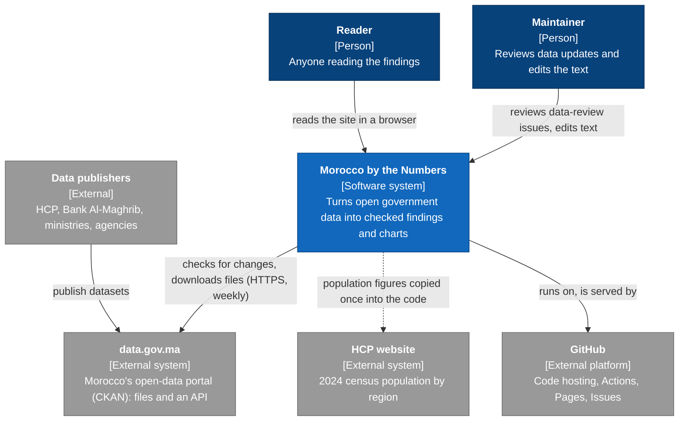
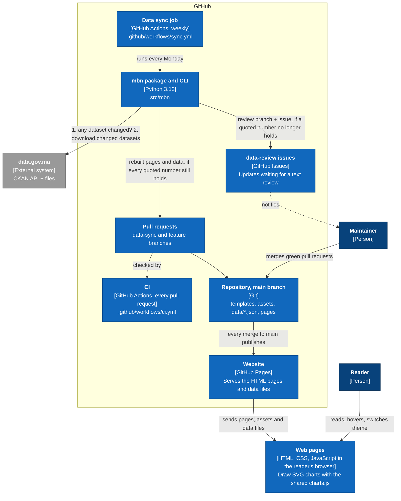
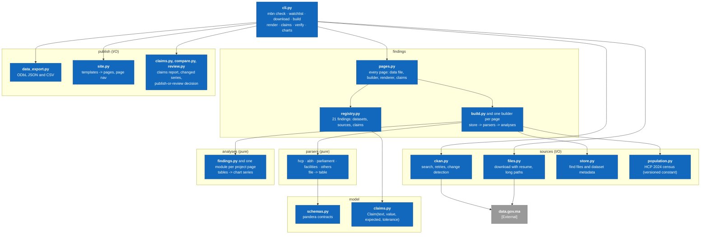
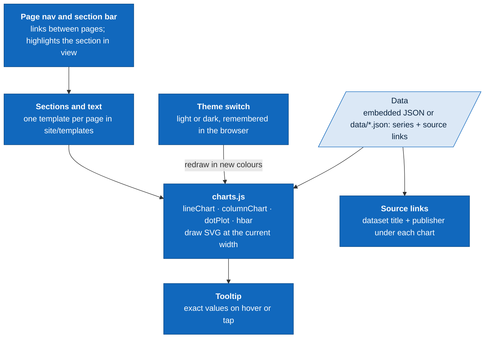

# Architecture

These diagrams follow the [C4 model](https://c4model.com): each level zooms into the one above it.

1. **System context**: who uses the site and which outside systems it depends on.
2. **Containers**: the pieces the project is made of and how data moves between them.
3. **Components**: the layers of the `mbn` package, and the parts of the web pages.
4. **Weekly sync**: what happens, step by step, when the scheduled job runs.

Key: blue boxes are part of this project; grey boxes are outside it.

## 1. System context



## 2. Containers



## 3a. Components: the mbn package

Each layer depends only on the layers above it in this list. Parsers and analyses are pure functions (no network, no disk writes), so they are fast to test; all input and output lives in `sources` and `publish`.



Design rules:

- **Adding a finding means adding one entry to the registry** (and a parser or analysis if the file is new). A new page is one entry in `pages.py`. The watch list (`data/datasets.txt`), the claims check, the page checks and the browser tests all read these lists; CI fails if the watch list is out of date.
- **Schemas at the boundaries.** pandera checks parser outputs (question files, daily series, price indices): types, ranges, no duplicates.
- **Nothing changes a published number silently.** The golden tests rebuild the data file and the page and compare them with snapshots taken before the refactor, and CI fails if a committed page is stale.

## 3b. Components: the web pages

Each page is a static HTML file at the site root. Pages share `site/assets/site.css` (tokens, light/dark theme) and `site/assets/charts.js` (chart library and helpers). The findings page embeds its data; other pages load theirs from `data/` with `fetch()`.



## 4. Weekly sync, step by step

```mermaid
sequenceDiagram
    autonumber
    participant A as GitHub Actions<br/>(Mondays 06:23 UTC)
    participant P as data.gov.ma
    participant M as mbn CLI
    participant B as Pull request
    participant C as CI
    participant I as Issues

    A->>M: mbn check
    M->>P: last-modified time of the watched datasets
    alt nothing changed, or a sync PR or review issue is already open
        A-->>A: stop (a few seconds)
    else a dataset changed
        M->>P: mbn download (watched datasets only)
        A->>M: mbn build, render, charts
        A->>M: mbn verify: figures moved? every claim holds?
        alt every quoted number still holds
            A->>B: open "Sync data from data.gov.ma" (label data-sync)
            A->>C: start CI on the branch
            C-->>B: lint, types, tests, browser checks
            Note over B,C: Maintainer merges when green;<br/>GitHub Pages publishes within a minute
        else a quoted number no longer holds
            A->>B: push data-review-YYYYMMDD branch
            A->>I: open "New data needs a text review"
            Note over I,B: Maintainer updates the text,<br/>opens a pull request, closes the issue
        end
    end
```
