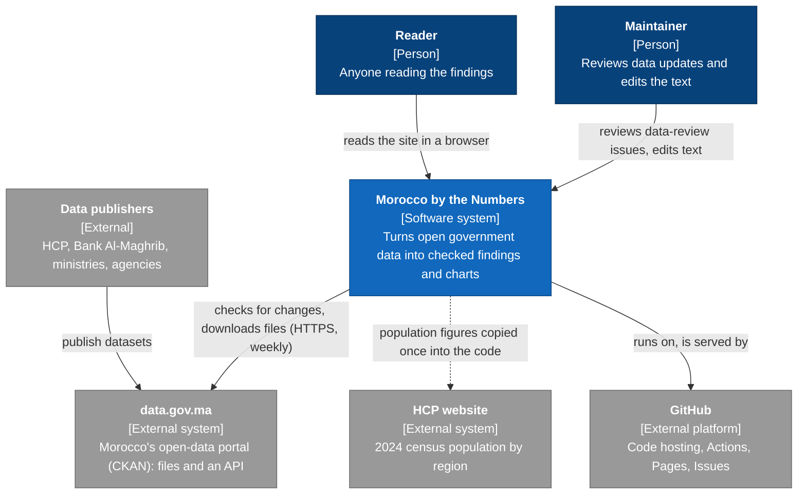
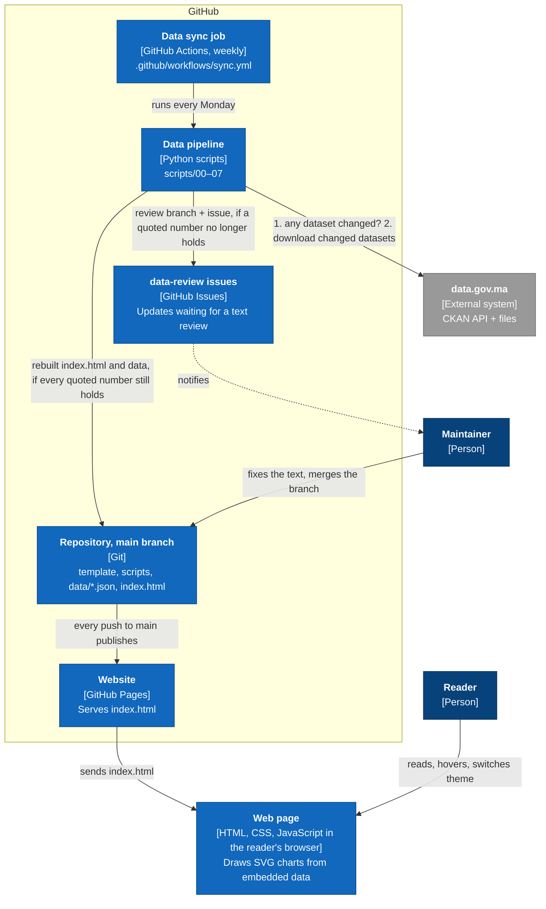
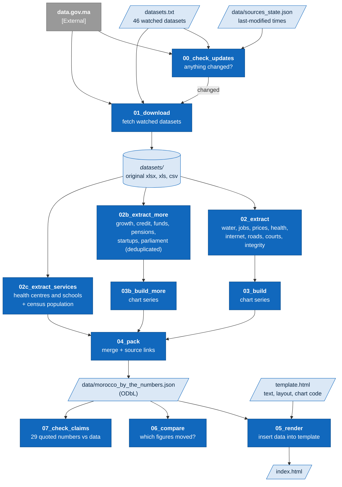
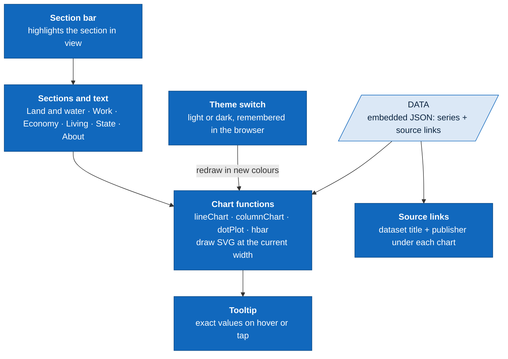
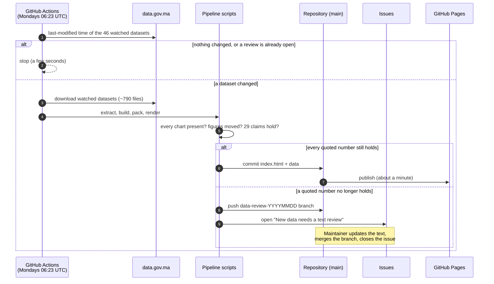

# Architecture

These diagrams follow the [C4 model](https://c4model.com): each level zooms into the one above it.

1. **System context**: who uses the site and which outside systems it depends on.
2. **Containers**: the pieces the project is made of and how data moves between them.
3. **Components**: the scripts inside the data pipeline, and the parts of the web page.
4. **Weekly sync**: what happens, step by step, when the scheduled job runs.

Key: blue boxes are part of this project; grey boxes are outside it.

## 1. System context

## 2. Containers

## 3a. Components: the data pipeline

Each script reads the previous step's output. Files in italics are temporary and not committed.

## 3b. Components: the web page

`index.html` is self-contained apart from Google Fonts. Everything below runs in the reader's browser.

## 4. Weekly sync, step by step

